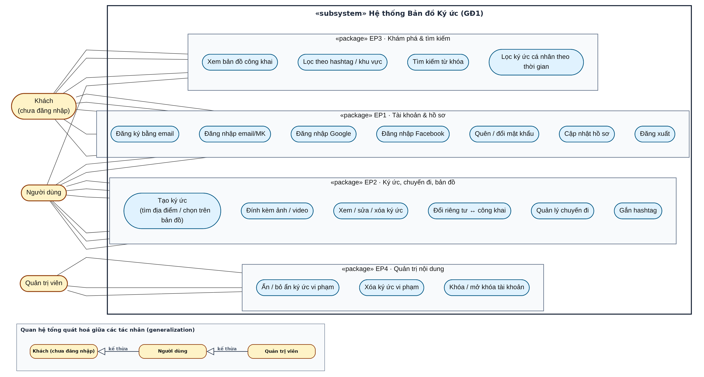

[← Danh mục sơ đồ](README.md)

# Sơ đồ use case

## Hình 1 — Sơ đồ use case tổng quát (GĐ1)

*3 tác nhân (Khách, Người dùng, Quản trị viên) và các use case theo 4 epic: EP1 Tài khoản & hồ sơ, EP2 Ký ức/chuyến đi/bản đồ, EP3 Khám phá & tìm kiếm, EP4 Quản trị nội dung. Đường nối thẳng từ mỗi tác nhân vào đúng use case họ thực hiện; khung «subsystem» bao quanh hệ thống; quan hệ tổng quát hoá (generalization, tam giác rỗng UML) giữa 3 tác nhân ở khung dưới cùng.*

Tham chiếu: SRS §2.3 — thay thế placeholder "Hình 1" trong file văn bản thuần
