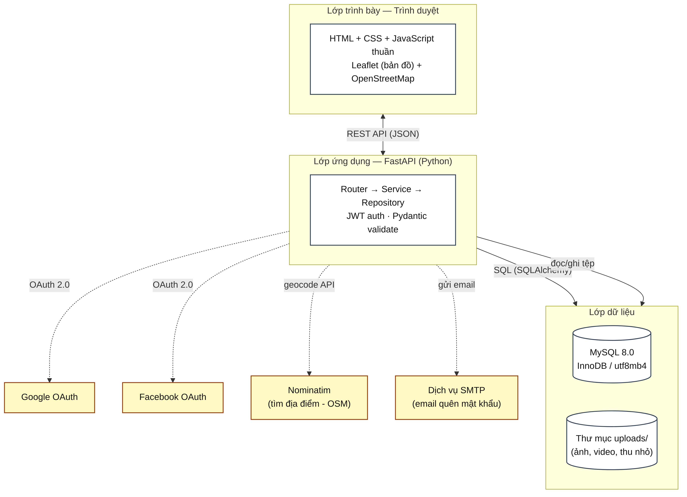
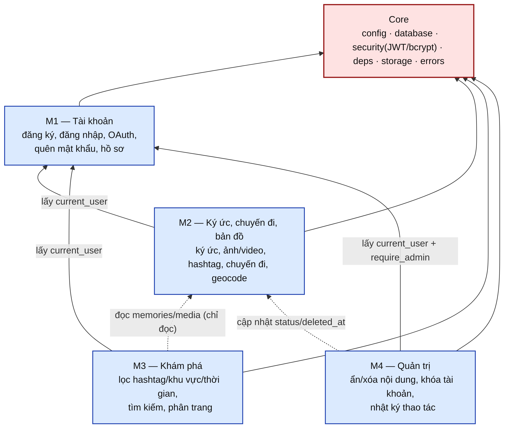

[← Danh mục sơ đồ](README.md)

# Kiến trúc và phụ thuộc module

## Hình 2 — Sơ đồ kiến trúc tổng thể (3 lớp)

*Lớp trình bày (trình duyệt, HTML/CSS/JS thuần + Leaflet) ⇄ Lớp ứng dụng (FastAPI: Router → Service → Repository, JWT auth) ⇄ Lớp dữ liệu (MySQL 8.0 + thư mục uploads/), cùng các dịch vụ ngoài: Google/Facebook OAuth, Nominatim (geocode), SMTP (email).*

Tham chiếu: SDD §1 — Kiến trúc tổng thể

## Hình 3 — Sơ đồ phụ thuộc module (Core, M1–M4)

*Core (config, database, security JWT/bcrypt, deps, storage, errors) được dùng chung bởi 4 module nghiệp vụ: M1 Tài khoản, M2 Ký ức/chuyến đi/bản đồ, M3 Khám phá, M4 Quản trị — kèm quan hệ phụ thuộc chéo giữa các module (lấy current_user, đọc chỉ đọc, cập nhật status/deleted_at).*

Tham chiếu: SDD §2 — Thiết kế module
