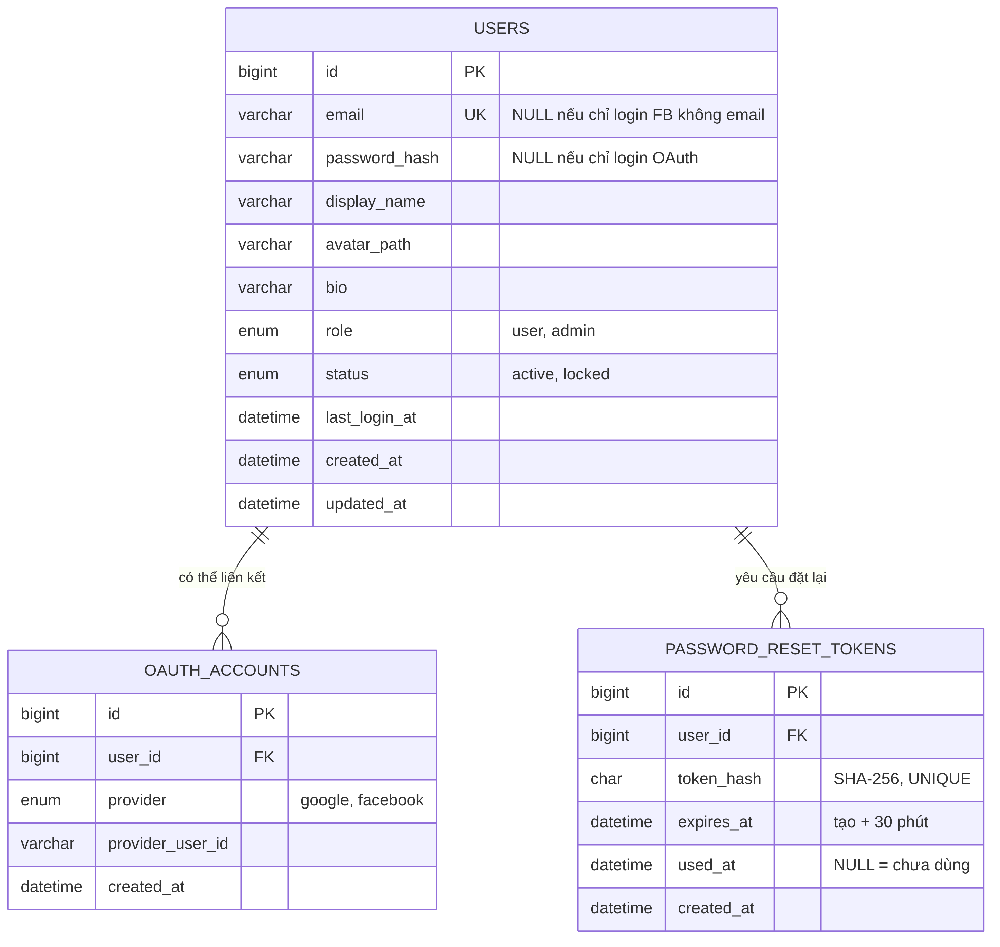
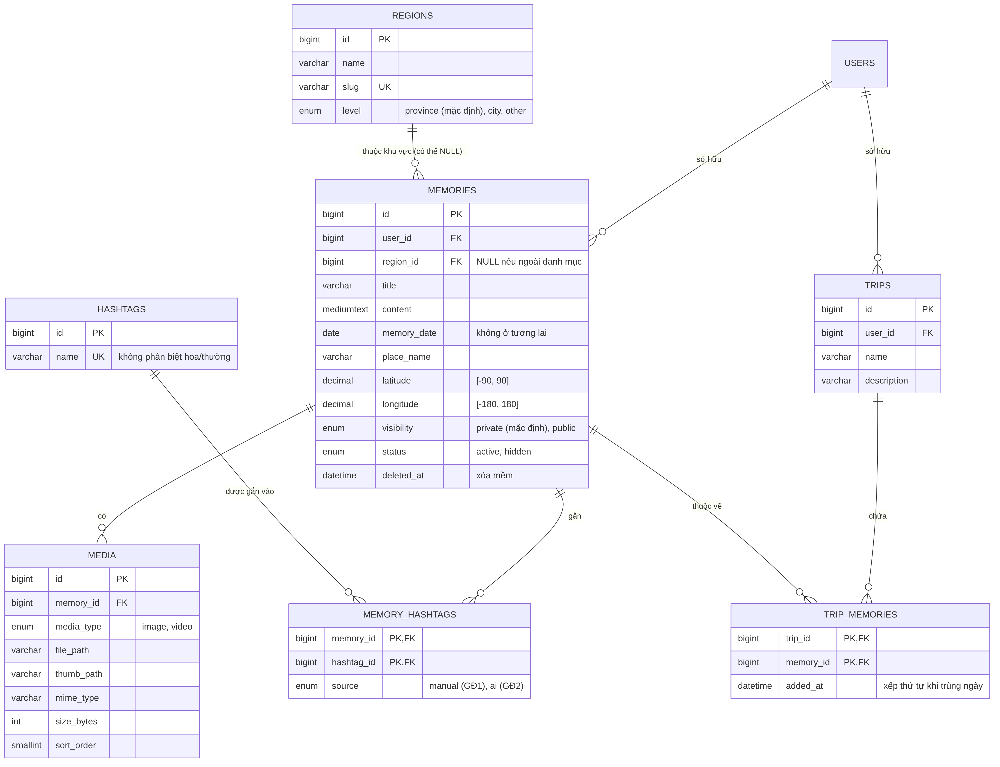
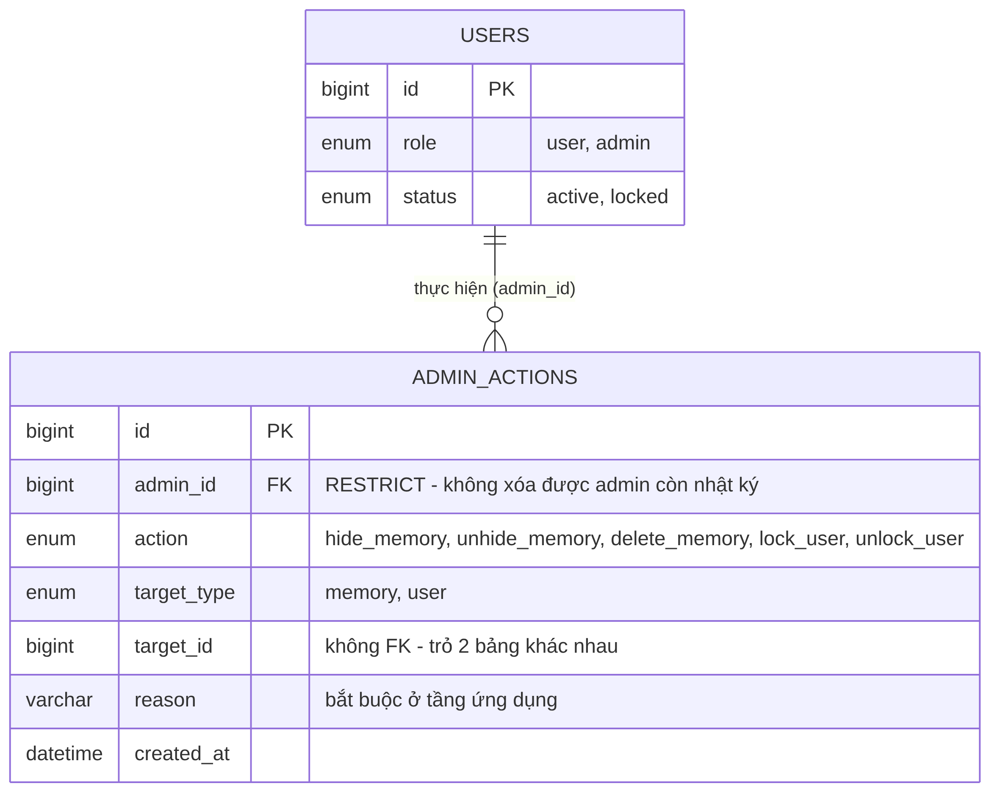

[← Danh mục sơ đồ](README.md)

# Sơ đồ thực thể liên kết (ERD)

## Hình 4 — ERD — Module Tài khoản

*Bảng USERS (tài khoản, hồ sơ, vai trò, trạng thái) liên kết với OAUTH_ACCOUNTS (liên kết Google/Facebook) và PASSWORD_RESET_TOKENS (yêu cầu đặt lại mật khẩu).*

Tham chiếu: SDD §3 — Thiết kế cơ sở dữ liệu; đối chiếu schema.sql

## Hình 5 — ERD — Module Ký ức, Chuyến đi, Bản đồ

*MEMORIES (trung tâm) liên kết USERS (sở hữu), REGIONS (khu vực), MEDIA (ảnh/video), MEMORY_HASHTAGS–HASHTAGS (gắn thẻ) và TRIP_MEMORIES–TRIPS (chuyến đi).*

Tham chiếu: SDD §3 — Thiết kế cơ sở dữ liệu; đối chiếu schema.sql

## Hình 6 — ERD — Module Quản trị

*ADMIN_ACTIONS ghi nhật ký mọi thao tác ẩn/xóa ký ức, khóa/mở khóa tài khoản của quản trị viên (USERS với role=admin), kèm lý do bắt buộc ở tầng ứng dụng.*

Tham chiếu: SDD §3 — Thiết kế cơ sở dữ liệu; đối chiếu schema.sql
