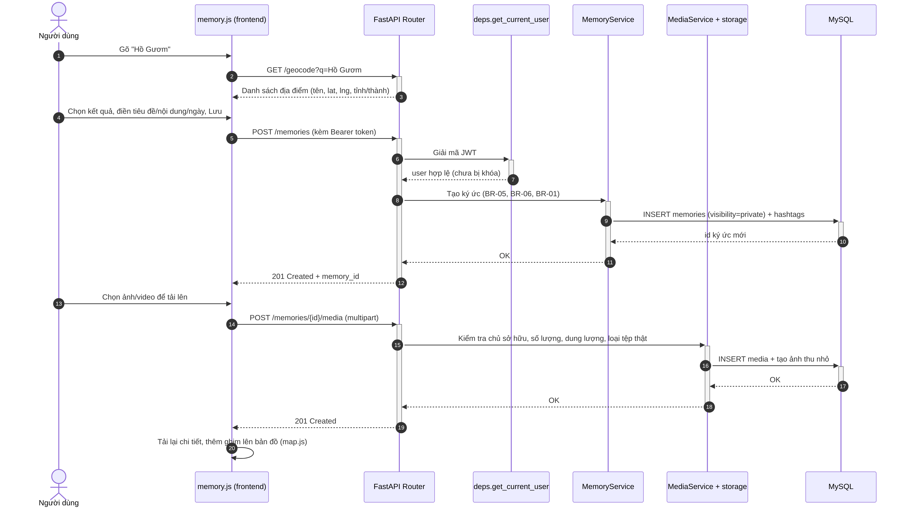
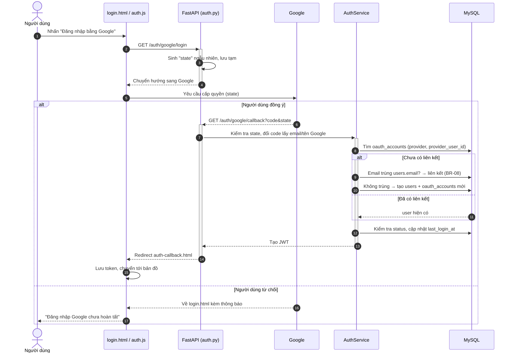
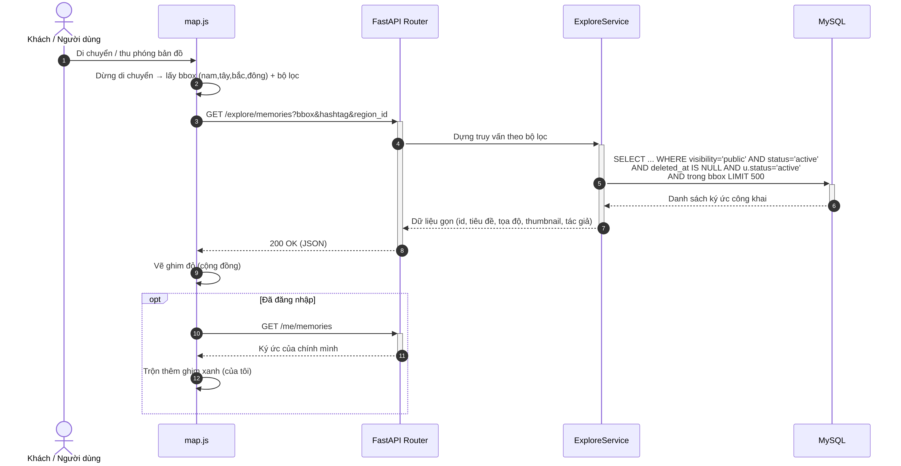

[← Danh mục sơ đồ](README.md)

# Luồng xử lý

## Hình 7 — Luồng xử lý — Tạo ký ức kèm ảnh

*Người dùng tìm địa điểm (geocode) → tạo ký ức (POST /memories, kiểm tra JWT, áp BR-05/BR-06/BR-01) → tải ảnh/video đính kèm (POST /memories/{id}/media) → cập nhật bản đồ.*

Tham chiếu: SDD §2.4 Luồng 1; SRS US-MEM-001, US-MEM-003

## Hình 8 — Luồng xử lý — Đăng nhập bằng Google

*OAuth 2.0 Authorization Code: sinh "state", chuyển hướng Google, callback đổi code lấy email/tên, tìm hoặc tạo liên kết tài khoản (liên kết theo email trùng — BR-08), tạo JWT; nhánh người dùng từ chối cấp quyền.*

Tham chiếu: SRS US-ACC-003

## Hình 9 — Luồng xử lý — Xem ghim công khai trong vùng nhìn bản đồ

*Di chuyển/thu phóng bản đồ → lấy bbox + bộ lọc → GET /explore/memories → truy vấn visibility='public' AND status='active' AND deleted_at IS NULL AND u.status='active' trong bbox → vẽ ghim đỏ (cộng đồng); nếu đã đăng nhập, trộn thêm ghim xanh (của mình).*

Tham chiếu: SRS US-EXP-001, US-EXP-002
