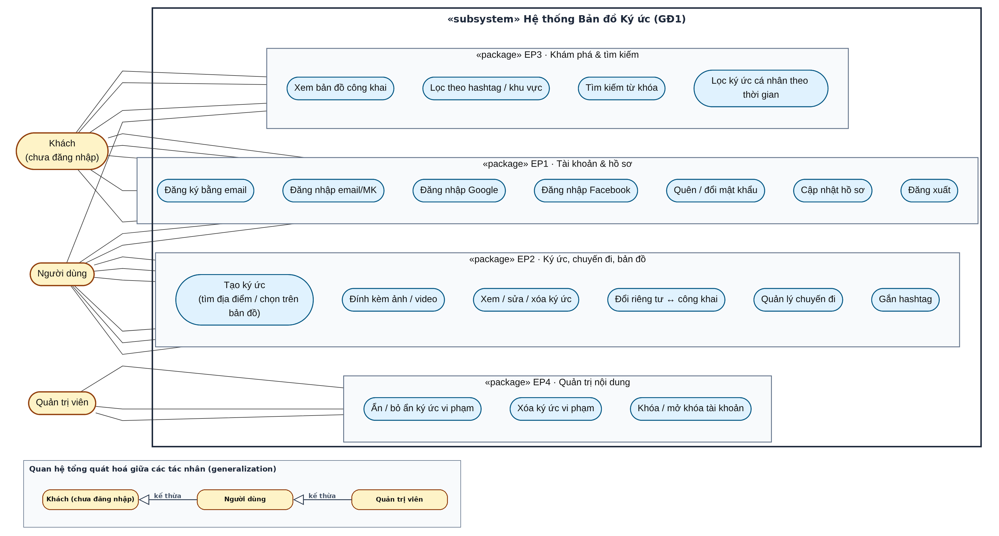

[← Mục lục SRS](README.md)

# 2. Mô tả tổng quan

## 2.1 Bối cảnh sản phẩm

Giới trẻ hiện nay thích đi phượt và chia sẻ trải nghiệm, khách du lịch thì cần tìm cảnh đẹp để trải nghiệm. Hiện chưa có nơi gộp cả hai nhu cầu: vừa là nhật ký cá nhân, vừa là bản đồ gợi ý địa điểm do cộng đồng đóng góp. Bản đồ Ký ức là sản phẩm độc lập, giao diện chính là một bản đồ toàn màn hình.

## 2.2 Đối tượng và vai trò người dùng

| **Vai trò**            | **Mô tả**                                                   | **Quyền chính**                                    |
|------------------------|-------------------------------------------------------------|----------------------------------------------------|
| Khách (chưa đăng nhập) | Người truy cập bất kỳ, thường là khách du lịch tìm cảnh đẹp | Xem bản đồ và ký ức công khai, lọc, tìm kiếm       |
| Người dùng             | Đã đăng ký/đăng nhập, thường là bạn trẻ thích đi phượt      | Toàn bộ chức năng cá nhân: ký ức, chuyến đi, hồ sơ |
| Quản trị viên          | Thành viên vận hành hệ thống                                | Ẩn/xóa nội dung vi phạm, khóa/mở khóa tài khoản    |

Đối tượng tiềm năng chính là các bạn trẻ thích đi phượt và khách du lịch, nhưng hệ thống hướng tới việc mọi người đều có thể sử dụng.

## 2.3 Sơ đồ use case tổng quát

*Hình 1 — Sơ đồ use case tổng quát (GĐ1). Xem chú thích đầy đủ ở [so-do/01-use-case.md](../so-do/01-use-case.md).*

## 2.4 Môi trường vận hành và công nghệ

- Ứng dụng web, chạy trên trình duyệt máy tính và điện thoại (responsive).

- Công nghệ dự kiến: Backend **FastAPI (Python)**, cơ sở dữ liệu **MySQL**, frontend **HTML/CSS/JavaScript thuần** tách thành các file riêng, bản đồ **Leaflet** với dữ liệu nền OpenStreetMap. Trong giai đoạn đồ án/demo, lưu trữ tại thư mục cục bộ uploads/ trên server. Khi triển khai thực tế trên Internet, sử dụng dịch vụ lưu trữ đối tượng (như AWS S3, Cloudinary hoặc ổ đĩa mạng của VPS).

- Năng lực nhóm: CSS, C, C++, HTML, JS, Python, FastAPI, Agile/Scrum, phân tích và thiết kế hệ thống.

## 2.5 Ràng buộc

- Nhóm 4 người làm theo Agile/Scrum; mỗi người phụ trách một phần.

- Giao diện và thông báo bằng tiếng Việt.

- Dùng dịch vụ bên ngoài miễn phí hoặc có hạn mức miễn phí (OpenStreetMap, Google/Facebook OAuth). Gửi email thật bằng SMTP của Gmail (App Password); môi trường phát triển dùng Mailtrap để kiểm thử mà không gửi email thật (gói Free của SendGrid đã ngừng từ 05/2025 nên không dùng). Dịch vụ tìm địa điểm: API Nominatim công khai của OpenStreetMap, tuân thủ đúng chính sách sử dụng (xem BR-19).

## 2.6 Giả định và phụ thuộc

- Người dùng có kết nối Internet.

- Phụ thuộc dịch vụ bên ngoài: Google OAuth, Facebook OAuth, dịch vụ bản đồ, dịch vụ gửi email (quên mật khẩu).

- Nhóm đăng ký được ứng dụng với Google và Facebook để dùng đăng nhập mạng xã hội.
